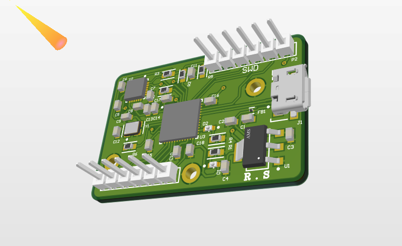
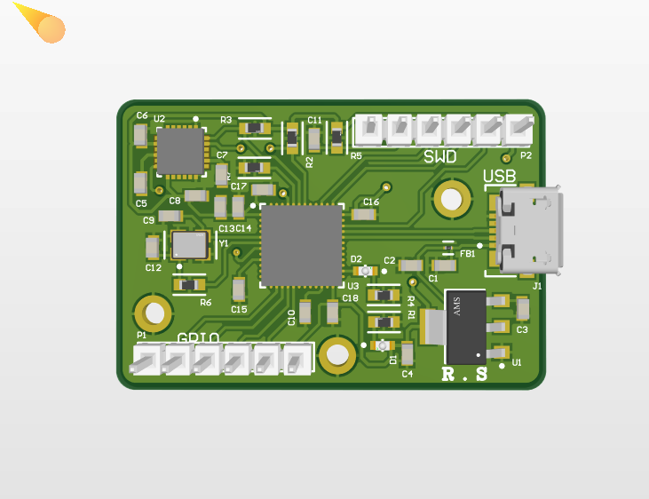
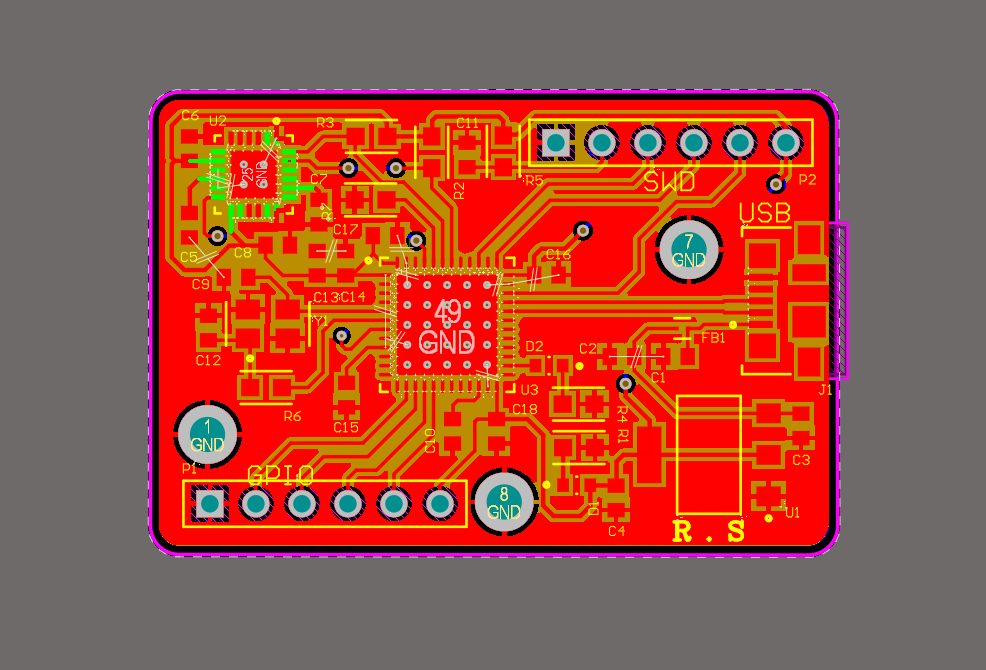
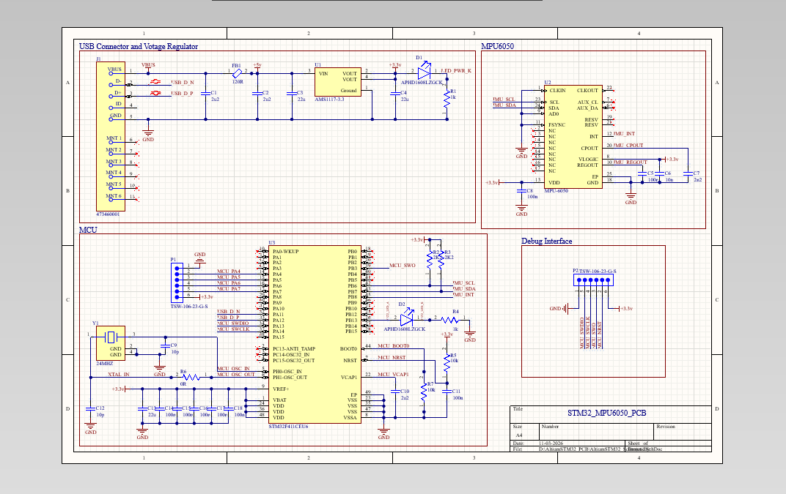

# STM32 MPU6050 PCB

**Custom Embedded Hardware Design using Altium Designer**

A four-layer PCB integrating an STM32 microcontroller and an MPU6050 six-axis motion sensor.

 

 

---

## Project Overview

This project covers the schematic and PCB design of a custom STM32-based board incorporating the MPU6050 inertial measurement unit (IMU).

The MPU6050 combines a three-axis accelerometer and a three-axis gyroscope. It communicates with the microcontroller through the I2C interface and can be used in motion sensing, orientation measurement and embedded control applications.

The board was designed in Altium Designer using a four-layer PCB stack-up.

---

## PCB Design Gallery

### 3D PCB View

### Additional 3D View

### PCB Layout

### Circuit Schematic

---

## Hardware Specifications

| Parameter | Description |
|:--|:--|
| Microcontroller | STM32 |
| Motion Sensor | MPU6050 |
| Sensor Type | 6-axis IMU |
| Accelerometer | 3-axis |
| Gyroscope | 3-axis |
| Communication Interface | I2C |
| PCB Architecture | 4-layer |
| Design Software | Altium Designer |

---

## PCB Layer Stack-up

| Layer | Function |
|:--|:--|
| L1 | Top Signal Layer |
| L2 | Ground Plane |
| L3 | Ground Plane |
| L4 | Bottom Signal Layer |

---

## Design Highlights

- STM32 microcontroller integration.
- MPU6050 accelerometer and gyroscope integration.
- I2C interface for sensor communication.
- Four-layer PCB stack-up.
- Dedicated internal ground layers.
- Component placement and signal routing.
- Custom connector and interface arrangement.
- 3D PCB visualisation using Altium Designer.

---

## Design Tools

---

## Repository Contents

| File / Folder | Description |
|:--|:--|
| `AltiumSTM32_PCB.PrjPcb` | Main Altium project |
| `AltiumSTM32_PCB.PcbDoc` | PCB layout document |
| `AltiumSTM32_Schematic.SchDoc` | Circuit schematic |
| `Components - 01.11.26 - 12.54/` | Project component libraries |
| `images/` | PCB renders, layout and schematic images |

---

## Applications

- Motion tracking.
- Orientation and tilt measurement.
- Inertial measurement systems.
- Robotics and embedded control.
- Sensor-based electronic systems.

---

## Author

**Ratnakar Sahoo**

Electronics and Telecommunication Engineering  
Veer Surendra Sai University of Technology (VSSUT), Odisha

[GitHub Profile](https://github.com/RatnakarSahooVSSUT)

[Project Repository](https://github.com/RatnakarSahooVSSUT/stm32_mpu6050_pcb)

---

**STM32 | MPU6050 | Embedded Hardware | PCB Design**

Designed using Altium Designer.

